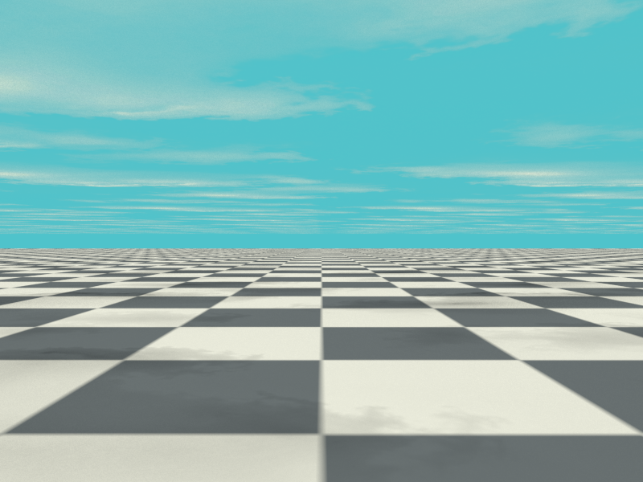
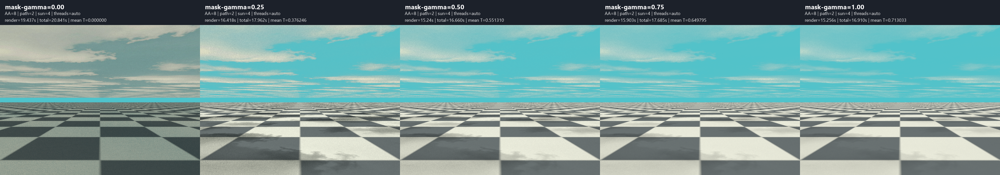

# JPEG cloud sheet with transparent sun shadows

A standalone C90/xmake client of the installed shared libYafaRay library.
A checkerboard ground lies below a horizontal textured cloud sheet. The camera
sits between them, looking toward the horizon. A turquoise constant background
shows through gaps in the clouds. A sun light above the sheet casts shadows
through the grayscale transparency texture onto the ground.



## Dependencies and build

The existing `tdm-gcc64-shared-opencv` preset now enables **JPEG, PNG and
OpenCV**. JPEG uses static libjpeg-turbo 3.2.0 built with TDM-GCC-64 10.3.0;
there is no additional JPEG DLL to distribute. The version's libjpeg-compatible
API is used by libYafaRay; the separate TurboJPEG API and SIMD assembly are
disabled in this build.

From the repository root in PowerShell:

```powershell
# First-time prerequisites, if not already installed
.\examples\texture_horizon\build_opencv.ps1
.\examples\mirror_tunnel\build_png.ps1

# Build JPEG dependency; validates the pinned official source archive and tests
.\examples\cloud_shadows\build_jpeg.ps1

& 'C:/Program Files/CMake/bin/cmake.exe' --preset tdm-gcc64-shared-opencv
& 'C:/Program Files/CMake/bin/cmake.exe' --build --preset tdm-gcc64-shared-opencv --parallel 4
& 'C:/Program Files/CMake/bin/cmake.exe' --install build/tdm-gcc64-shared-opencv
```

The JPEG source archive comes from the official
[libjpeg-turbo 3.2.0 release](https://github.com/libjpeg-turbo/libjpeg-turbo/releases/tag/3.2.0).
The dependency script checks its SHA-256, installs to
`build/install/jpeg-tdm-gcc64`, and runs the upstream regression tests.
The libYafaRay installation remains `build/install/tdm-gcc64-shared-opencv`.

Then, from `examples/cloud_shadows`:

```powershell
& C:/temp/xmake/xmake.exe f -p mingw -a x86_64 -m release --sdk=C:/temp/TDM-GCC-64 --yafaray_prefix=../../build/install/tdm-gcc64-shared-opencv
& C:/temp/xmake/xmake.exe
& C:/temp/xmake/xmake.exe run yafaray_cloud_shadows

# Faster preview
xmake run yafaray_cloud_shadows preview.png --aa-samples 4 --path-samples 2 --light-samples 4

# Control: identical cloud appearance, but no sun shadows on the ground
xmake run yafaray_cloud_shadows no-shadows.png --no-cloud-shadows

# Darken the transparency mask: denser clouds and stronger ground shadows
xmake run yafaray_cloud_shadows dense.png --mask-gamma 0.5

# Fully opaque cloud sheet, ignoring the original mask values
xmake run yafaray_cloud_shadows opaque.png --mask-gamma=0

# Lighten the mask: more transparent clouds
xmake run yafaray_cloud_shadows thin.png --mask-gamma 2

# More sampling and explicit worker count
xmake run yafaray_cloud_shadows quality.png --aa-samples 32 --path-samples 8 --light-samples 16 --threads 4
```

The default is `build/cloud_shadows.png`, 800 x 600. PNG is written directly
by libYafaRay. A lowercase `.tga` output is also accepted. Relative output
filenames are resolved in the target's `build` run directory. Texture paths
are resolved from that directory as `../textures/...`; use `xmake run` from
the example directory so the configured run directory is used.

| Option | Default | Meaning |
| --- | --- | --- |
| `--aa-samples N` | 16 | Camera samples per pixel |
| `--path-samples N` | 4 | Diffuse indirect-light samples |
| `--light-samples N` | 8 | Sunlight samples |
| `--threads N` | -1 | Workers; -1 selects automatically |
| `--ray-depth N` | 8 | Specular/transparent camera-ray recursion, 1..128 |
| `--no-cloud-shadows` | off | Disable the sun's `cast_shadows` for a control render |
| `--mask-gamma G` | 1 | Nonnegative finite mask gamma; 0=opaque, 1=original, >1=lighter |
| `--help` | | Show usage without rendering |

## Texture and transparency setup

The two user-supplied JPEG files have been moved into this example's
`textures/` directory, preserving their original filenames and contents:

* `turquoise-sky-pbr-texture_color.jpeg` is loaded as **sRGB** and connected
  through a `texture_mapper` to `diffuse_shader`.
* `turquoise-sky-pbr-texture_transparency.jpeg` is loaded as **LinearRGB data**
  and connected to `transparency_shader`, with `do_scalar=true`.

Both textures use bilinear interpolation and the same world-space planar XY
mapping, scale `(1/12,1/12,1)`: one image repeats every **24 world units**.
Using identical mapping keeps color and transparency registered. The shader's
coordinate conversion accounts for libYafaRay's image Y orientation.

The cloud material is `shinydiffusemat`. In its transparency input,
**white means transparent, black means opaque**, with gray values giving
intermediate transmission. This mask already has white sky gaps and dark
clouds, so it is used without inversion. `transmit_filter=0` makes transmitted
light neutral rather than tinting it with the JPEG color. The color image is
not used as the transparency mask, and the mask is not treated as sRGB.

These are the user's existing assets, not newly downloaded textures. Their
original source and license were not supplied beyond the filenames.

## Mask gamma and comparison from 0 to 1

`--mask-gamma G` changes **only the transparency mask**, not the color JPEG,
background, lights or output gamma. It is applied to the loaded linear mask
texels in memory before texture interpolation; neither JPEG file is modified.

For original mask value `M` in `[0,1]`:

```text
G = 0:  T = 0 everywhere (fully opaque sheet)
G > 0:  T = M^(1/G)
```

Thus `G=0.5` squares the mask (darker, less transparent), `G=1` keeps it
unchanged, and `G=2` takes its square root (lighter, more transparent).
At `G=1` the original image buffer is not rewritten. Gamma is not a linear
opacity multiplier. At any positive G, exact black/white values stay 0/1;
the zero setting is an explicit override that also makes white texels opaque.
Negative values, NaN, infinity and malformed values are rejected before
rendering. Decimal arguments use a dot.

The following comparison was rendered on 4 November 2026 with **AA=8,
path samples=2, sun samples=4, ray depth=8 and 8 detected workers**, using the
same camera, textures and lighting. These settings are lower than the default
16/4/8 illustration, so some sampling noise is visible. Run directory:
`build/gamma-comparison/20261104-153202-326`.

```powershell
# Render 0, 0.25, 0.5, 0.75 and 1; create labeled PNG strip and timings.csv
.\compare_gamma.ps1

# Regenerate the comparison from a completed run without rendering again
.\compare_gamma.ps1 -ExistingRunDirectory build/gamma-comparison/20261104-153202-326
```

| Mask gamma | Mean mask transparency | Renderer-only time | Launch + render + PNG save |
| --- | --- | --- | --- |
| 0.00 | 0.00% | 19.437 s | 20.841 s |
| 0.25 | 37.62% | 16.418 s | 17.962 s |
| 0.50 | 55.13% | 15.240 s | 16.660 s |
| 0.75 | 64.98% | 15.903 s | 17.685 s |
| 1.00 | 71.30% | 15.256 s | 16.910 s |

Left to right: **0 — 0.25 — 0.5 — 0.75 — 1**. The strip preserves original
PNG pixels and alpha, with no resampling, denoising or color adjustments.



At zero the sheet blocks all direct sun rays through its covered area, so
ground lighting is mainly fill and indirect light; individual cloud shadows
merge into broad overall shade. The color JPEG itself contains sky-colored
areas, which remain visible as part of the opaque textured surface. A narrow
background strip near the horizon can also remain because the plane is finite.

**Use 0.25–0.5 for denser, more distinct clouds and stronger shadow contrast;
0.75 for a gentler change; 1 for the original supplied mask.** Zero is useful
as the opaque reference, rather than a realistic cloud setting. The mean
transparency in the table is the arithmetic mean of the corrected mask's RGB
texel values; it is not a percentage of screen pixels showing clear sky or a
complete lighting/transmission measure.

The full five-render sequence took about **90 seconds**, excluding comparison
generation. These are single local timings, not a universal relationship
between gamma and render cost. An extra G=2 render confirmed the supported
brightening direction: mean mask transparency increased to **83.37%**.

## Geometry, background and light

Ground: `z=-0.01`, spanning X/Y from -200 to 200. Its generated two-color
checker repeats every 10 units, with approximately 5-unit cells.
Cloud sheet: `z=6`, with the same extent and normals pointing downward.
Camera: `(0,-8,3)`, looking horizontally toward `(0,12,3)`, perspective
`focal=0.80`. Thus the camera is below the clouds and above the ground.
Both planes are finite; a narrow view beyond their distant edges can show
the background near the horizon.

The constant background is turquoise, linear RGB `(0.08,0.55,0.60)`.
The sun uses `type=sunlight`, direction `(0.45,-0.30,1)` **toward the sun**,
power 1.4, warm-white color, and angular half-size 0.27 degrees. This is a
directional source with a small angular extent; its shadows are filtered by
the cloud mask and softened slightly by the angular size.

The pathtracing integrator has `transpShad=true` and `shadowDepth=8`, allowing
shadow rays to use material transparency rather than treating the cloud plane
as a solid ceiling. `raydepth=8` allows camera rays through transparent areas.
Three diffuse bounces provide indirect fill.

Two non-shadow-casting directional fill lights keep the example readable:
an upward direction at power 0.15 fills the ground shadows, and a downward
direction at power 0.75 lights the visible underside of the cloud sheet.
These are artistic approximations of sky/ground fill, not an atmospheric
scattering simulation. The shadows are cast by the sun, not by these fills.

This is a **flat textured transparency layer**, not volumetric clouds:
there is no thickness, multiple scattering or changing cloud silhouette when
viewed from different sides. The JPEG already contains photographed shading;
lighting the sheet adds another simplified surface-lighting response.

## Verification

Built and rendered on 4 November 2026 with TDM-GCC-64 10.3.0, xmake 3.1.2,
and the rebuilt JPEG/PNG/OpenCV-enabled DLL. All **211 libjpeg-turbo tests**
passed. Both JPEG files were loaded by libYafaRay's `JpgFormat`, as confirmed
by the render log. The DLL still imports only Windows system runtime DLLs;
JPEG, PNG dependencies and OpenCV are linked statically.

The default 16/4/8 render with 8 detected workers took **88.469 seconds** of
renderer time. A 4/2/4 preview took 8.215 seconds. Times are single local
measurements, not guarantees.

Matched 4/2/4 controls with and without sun shadows confirmed the cloud-shadow
effect. In the ground region `x=[0,800)`, `y=[350,580)`, the shadowed image was
10.33 RGB levels darker on average (0..255 scale), and 130,589 of 184,000
pixels were more than 3 levels darker. This is a scene-specific check using
the mean of R/G/B differences, not a physically linear luminance measure.
The sky appearance was retained in the control; the comparison changes the
sun's shadow switch rather than removing the cloud geometry.

The final PNG passed size, chunk CRC and complete decompressed pixel-stream
checks and was visually inspected. A `texture_horizon` EWA render with the
new DLL also passed and logged 6 mipmap levels per texture, confirming that
OpenCV support remains functional.

After adding mask gamma, the client rebuilt without warnings. Negative, NaN,
infinite, overflowing and empty gamma arguments were rejected; both separated
and equals argument forms were exercised. The five comparison outputs passed
PNG validation. G=0 logged exactly zero mean transparency, and the corrected
mean values increased monotonically through G=1 and the additional G=2 check.
At G=1 the correction function returns the original texel values and the image
buffer is not rewritten. Render-to-render Monte Carlo noise is not used as a
test of exact mask identity.

The saved PNG is the direct renderer output without retouching. Working
renders, logs and dependency builds remain in ignored `build` directories.
