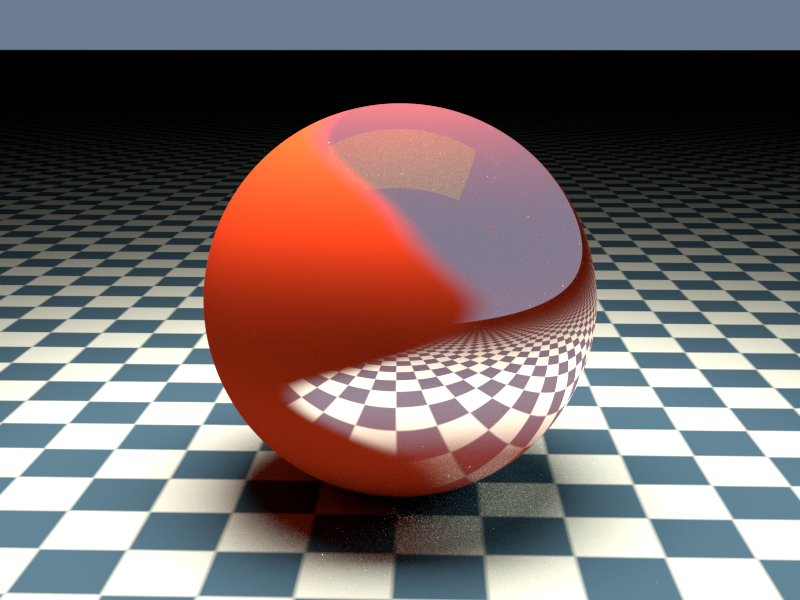
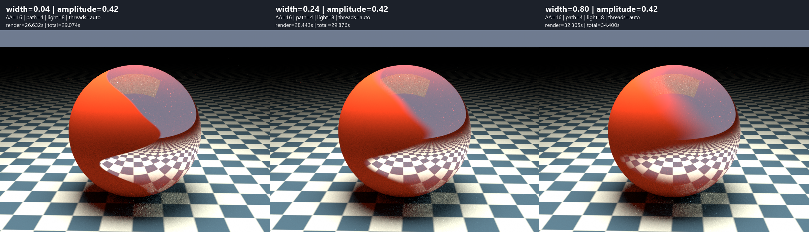
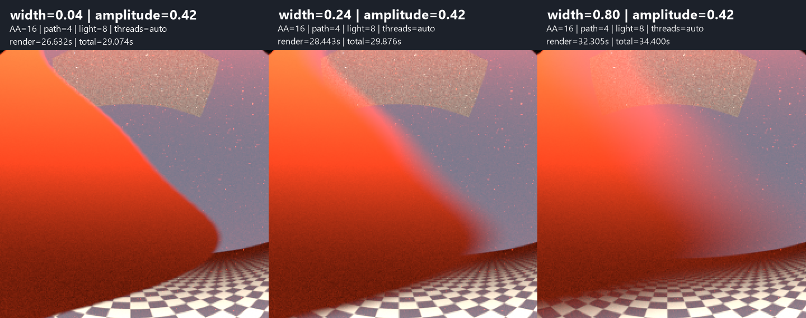

# A sphere with a wavy matte-to-mirror transition

An independent C90/xmake example using the installed shared libYafaRay library.
One analytic sphere blends orange-red matte paint with a polished mirror using
a smooth grayscale mask. A checkerboard floor and a large overhead area light
make the reflected part easy to recognize. The transition follows a wavy line
on the sphere, rather than the intersection with a single flat cutting plane.



## Build and render directly to PNG

Requires the PNG-enabled shared installation prepared for
[mirror_tunnel](../mirror_tunnel/README.md#build-and-run). The library uses
CMake; this example uses xmake with the same TDM-GCC-64 compiler.
From `examples/material_blend` in PowerShell:

```powershell
& C:/temp/xmake/xmake.exe f -p mingw -a x86_64 -m release --sdk=C:/temp/TDM-GCC-64 --yafaray_prefix=../../build/install/tdm-gcc64-shared-opencv
& C:/temp/xmake/xmake.exe
& C:/temp/xmake/xmake.exe run yafaray_material_blend

# Quick composition preview
xmake run yafaray_material_blend preview.png --aa-samples 4 --path-samples 2 --light-samples 4

# Explicit PNG filename and worker count
xmake run yafaray_material_blend sphere.png --threads 4

# Change the mask without recompiling
xmake run yafaray_material_blend soft.png --transition-width 0.80 --wave-amplitude 0.42
xmake run yafaray_material_blend small-waves.png --transition-width=0.24 --wave-amplitude=0.15

# Zero amplitude removes both sine waves (a planar projected boundary)
xmake run yafaray_material_blend no-waves.png --wave-amplitude 0

# TGA is also available by changing the extension
xmake run yafaray_material_blend sphere.tga
```

The default output is `build/material_blend.png`, 800 x 600. Relative output
paths are resolved in `build`, the target's working directory. PNG is written
directly by the installed library and libpng, without an intermediate TGA or
Python image conversion. Use lowercase `.png` or `.tga` extensions.

| Option | Default | Meaning |
| --- | --- | --- |
| `--aa-samples N` | 32 | Film `AA_minsamples`; edge and camera sampling |
| `--path-samples N` | 8 | Diffuse indirect-light samples |
| `--light-samples N` | 8 | Area-light samples; soft-shadow noise |
| `--threads N` | -1 | Render workers; -1 selects automatically |
| `--ray-depth N` | 8 | Specular recursion limit, accepted range 1..128 |
| `--transition-width W` | 0.24 | Smooth transition width in world X; finite `0 < W <= 3` |
| `--wave-amplitude A` | 0.42 | Main sine amplitude in world units; finite `0 <= A <= 1.2` |
| `--help` | | Show usage without rendering |

Sample counts must be positive integers. Options accept `--name N` or
`--name=N`. Unsupported extensions and invalid counts are rejected before
rendering. Mask parameters accept decimal numbers; NaN, infinity, out-of-range
values and zero transition width are rejected before rendering. The application
checks the resulting PNG signature, IHDR dimensions
and terminal IEND chunk, or the TGA header and pixel-data size.

## Material and mask setup

Two ordinary materials are created first, followed by a third material that
references them by name:

| Material | Type and settings |
| --- | --- |
| `matte_paint` | `shinydiffusemat`, linear RGB `(0.65, 0.045, 0.012)`, `diffuse_reflect=1`, `specular_reflect=0` |
| `polished_mirror` | `mirror`, white color, `reflect=0.95` |
| `wavy_blend` | `blend_mat`, `material1=matte_paint`, `material2=polished_mirror`, `blend_shader=mask_mapper` |

The sphere uses **only `wavy_blend`**, rather than two overlapping sphere meshes.
The node path is:

```text
512 x 512 grayscale image -> image texture -> texture_mapper -> blend_shader
                                                              |
                               blend_mat(matte_paint, polished_mirror)
```

Mask value **0 selects matte paint**, **1 selects mirror**, and intermediate
values blend the material response. This changes reflection strength as well
as the diffuse contribution; it is not simply a blend between two paint colors.
`blend_value=0.5` supplies a fallback constant, but the connected `blend_shader`
provides the actual spatially varying value. `mask_mat` is deliberately not
used because its threshold would make a hard material switch.

The mask image is generated in memory in `blended_sphere`. It stores equal
R/G/B components, with `color_space=LinearRGB` and `image_optimization=none`.
These are numeric blend weights: applying an sRGB decoding curve would change
the meaning of the gray values. The image texture uses `interpolate=bilinear`,
and its `texture_mapper` has `do_scalar=true` to supply a float to the material.
There are no external texture assets.

## Wavy boundary and smooth transition

For world position `(x,z)`, the boundary is:

```text
t = z - 1.2
boundary(z) = A * (sin(4.8*t) + (2/7) * sin(9*t + 0.6))
q = clamp(0.5 + (x - boundary(z)) / W, 0, 1)
mask = q*q*(3 - 2*q)
```

Here `A` is `--wave-amplitude` and `W` is `--transition-width`. The second sine
amplitude scales with the first at a fixed ratio of 2/7, preserving the original
0.42/0.12 shape at the defaults. `A=0` removes both waves; larger values make
the boundary meander further left and right. A is the first sine's amplitude,
not the exact maximum displacement of the sum.

Smoothstep gives a gradual transition across **W world units measured along X**
(0.24 by default); outside that band
the mask reaches pure black or white. This is a projected width, not a constant
distance measured along the curved surface. Width and amplitude can be changed
from the command line without rebuilding. Frequencies, phase and the secondary
amplitude ratio remain fixed in `blended_sphere`. Increasing the width softens
the transition; decreasing it makes
the border sharper. No geometry displacement or bump mapping is applied.

The mapper uses `texco=global`, `mapping=plain`, `proj_x=1`, `proj_y=3`,
`proj_z=2`: it projects world X/Z onto the mask. Its scale is `(2/3,2/3,1)`
and offset `(0,-0.4,0)`. Combined with libYafaRay's image-coordinate conversion,
the mask covers `x=[-1.5,1.5]`, `z=[-0.3,2.7]`. The generation loop accounts for
the image Y flip. This domain contains the whole sphere and avoids texture
wrap seams on it. Because these are world coordinates, moving the sphere
without moving the mapping would move it through the mask.

The sphere is centered at `(0,0,1.2)` with radius 1.2. The camera at
`(0.2,-6.5,2.8)` looks toward `(0,0,1.2)`, with perspective `focal=1.35`.
A downward-facing 4 x 3 area light at height 5, power 8, and `pathtracing`
with 3 diffuse bounces provide lighting. Mirror reflections of the checkerboard,
background and rectangular light are distinct from the matte paint.

## Transition width comparison

Rendered on 4 November 2026, using the same installed PNG/OpenCV-enabled DLL,
800 x 600 image, camera, scene and wave amplitude **0.42** throughout.
All three profiles use **AA=16, path samples=4, light samples=8, ray depth=8**
and 8 automatically selected workers. These are deliberately identical sampling
settings, lower than the 32/8/8 defaults used for the introductory illustration.
Run directory: `build/width-comparison/20261104-142744-486`.

```powershell
# Render all three widths, record timings, and create labeled comparisons
.\compare_widths.ps1

# Regenerate the PNG strips from an existing run without rerendering
.\compare_widths.ps1 -ExistingRunDirectory build/width-comparison/20261104-142744-486
```

| Transition width | Renderer-only time | Launch + render + PNG save | Appearance |
| --- | --- | --- | --- |
| 0.04 | 26.632 s | 29.074 s | Nearly sharp, clearly wavy material boundary |
| 0.24 | 28.443 s | 29.876 s | Moderate smooth transition; useful default |
| 0.80 | 32.305 s | 34.400 s | Broad mixed region; softer and less distinct material separation |

Left to right: **0.04 — 0.24 — 0.80**. Labels include width, amplitude,
sampling settings and measured times.



The identical original region `x=[280,520)`, `y=[140,380)` at 2x enlargement
using nearest-neighbor sampling, without smoothing:



**Choose 0.04 for a paint/coating edge, 0.24 for a visibly smooth material
transition, and 0.80 for a deliberately broad blend.** The wave shape stays
fixed in this experiment; only the transition band changes. A larger width
does not blur reflected objects or add surface roughness: it increases the
region where matte diffuse response and sharp mirror reflection coexist.
All views retain some Monte Carlo noise at these settings.

The wider blend took about 21% longer than the narrow one in this single run.
This is not a general timing rule; the region in which both material responses
contribute changes with width, and scheduling also affects these measurements.
The total measured render/launch/save time was about **93 seconds**, excluding
comparison generation. The script preserves source PNG pixel/alpha values
when assembling the strips instead of compositing them against the label
background.

## Verification

Built and rendered on 4 November 2026 with TDM-GCC-64 10.3.0, xmake 3.1.2
and the installed PNG/OpenCV-enabled libYafaRay shared library. The default
32/8/8 render used 8 detected workers and took **92.332 seconds** of renderer
time. Preview renders at 4/2/4 completed in about 4 seconds. These are single
local measurements, not timing guarantees.

The final PNG passed dimension, chunk CRC and complete decompressed pixel-stream
checks and was visually inspected. The example built without compiler warnings;
`--help` and rejection of an unsupported `.jpg` output were also checked.
After adding the mask options, the example rebuilt without warnings. Zero,
NaN and out-of-range widths, and negative, infinite and out-of-range amplitudes
were rejected. An additional render with `--wave-amplitude=0` and
`--transition-width=0.24` confirmed zero amplitude and the equals syntax work.

The saved illustration is the native PNG render, without denoising, conversion
or retouching. It is kept in `images/`; executables, logs and working renders
remain under ignored `build` directories.
