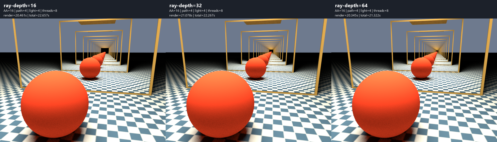
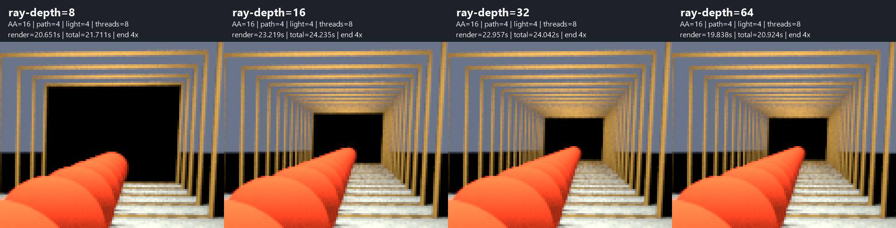
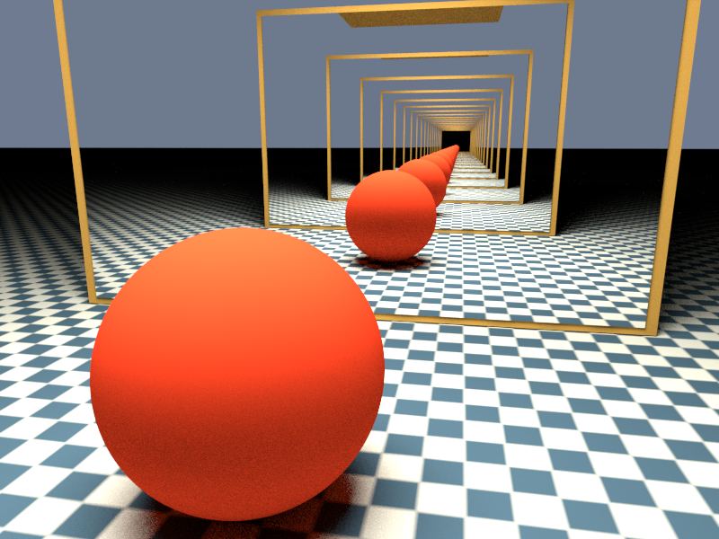

# Facing mirrors: a reflection tunnel

A standalone C90/xmake example linked to the installed shared libYafaRay
library. Two parallel rectangular mirrors face each other above a textured
floor, with one coral-colored sphere between them. The camera looks into the
front mirror from inside the gap, slightly off-axis, revealing nested mirror
frames and a receding chain of reflected spheres.

## Build and run

The installed library now includes **PNG, JPEG and OpenCV**. The existing
`tdm-gcc64-shared-opencv` preset keeps OpenCV enabled and also enables
`YAFARAY_WITH_PNG` (and JPEG for `cloud_shadows`). It uses static libpng 1.6.59 and zlib 1.3.2 built with
the same TDM-GCC-64 compiler; no additional PNG/zlib DLLs are needed.

To reproduce the dependency and library build, from the repository root:

```powershell
# Requires the OpenCV installation prepared for texture_horizon
# (examples/texture_horizon/build_opencv.ps1 builds it if needed).
.\examples\mirror_tunnel\build_png.ps1
.\examples\cloud_shadows\build_jpeg.ps1
& 'C:/Program Files/CMake/bin/cmake.exe' --preset tdm-gcc64-shared-opencv
& 'C:/Program Files/CMake/bin/cmake.exe' --build --preset tdm-gcc64-shared-opencv --parallel 4
& 'C:/Program Files/CMake/bin/cmake.exe' --install build/tdm-gcc64-shared-opencv
```

The dependency script downloads pinned source archives from the official
[libpng repository](https://github.com/pnggroup/libpng/tree/v1.6.59) and
[zlib site](https://zlib.net/), checks SHA-256 hashes, builds and installs
static libraries under `build/install/png-tdm-gcc64`, and runs zlib tests
and the upstream `pngtest` linked to the installed static libraries.
The libYafaRay shared-library installation stays at
`build/install/tdm-gcc64-shared-opencv`.

From this directory in PowerShell, using the existing TDM-GCC-64 installation:

```powershell
& C:/temp/xmake/xmake.exe f -p mingw -a x86_64 -m release --sdk=C:/temp/TDM-GCC-64 --yafaray_prefix=../../build/install/tdm-gcc64-shared-opencv
& C:/temp/xmake/xmake.exe
& C:/temp/xmake/xmake.exe run yafaray_mirror_tunnel
```

The default output remains `build/mirror_tunnel.tga`, 800 x 600. A relative output
filename is resolved inside `build`, the target's run directory. Override
`--yafaray_prefix` to use another compatible MinGW shared-library installation.
This scene uses bilinear image filtering and does not require OpenCV; the
default prefix selects the installation already used by the other examples.
The library itself continues to use CMake.

## Save directly to PNG or TGA

Choose the writer with the output filename's **lowercase** `.png` or `.tga`
extension. PNG is written directly by libYafaRay/libpng during output flush;
no intermediate TGA, Python conversion, or OpenCV PNG codec is involved.
The example rejects other extensions before rendering. PNG requires a
PNG-enabled library; supplying an older installation without it will fail
output verification rather than report a successful render.

```powershell
# Direct PNG, using the default scene and quality settings
xmake run yafaray_mirror_tunnel mirror_tunnel.png

# PNG with a longer reflection chain
xmake run yafaray_mirror_tunnel depth64.png --ray-depth 64 --aa-samples 16 --threads -1

# TGA remains supported
xmake run yafaray_mirror_tunnel mirror_tunnel.tga

# Quick camera/geometry preview
xmake run yafaray_mirror_tunnel preview.tga --aa-samples 4 --path-samples 2 --light-samples 4

# Cleaner image
xmake run yafaray_mirror_tunnel mirror_tunnel.tga --aa-samples 32 --path-samples 8 --light-samples 8

# Shorter reflection chain, for comparison
xmake run yafaray_mirror_tunnel depth8.tga --ray-depth 8

# Extend the chain and select workers
xmake run yafaray_mirror_tunnel depth64.tga --ray-depth 64 --threads 4

# Optional conversion of an existing TGA; unnecessary for direct PNG output
python -B create_preview.py build/mirror_tunnel.tga build/mirror_tunnel.png
```

| Option | Default | Effect |
| --- | --- | --- |
| `--aa-samples N` | 16 | Film `AA_minsamples`; camera/edge sampling |
| `--path-samples N` | 4 | Diffuse indirect-light samples |
| `--light-samples N` | 4 | Area-light samples; shadow noise |
| `--ray-depth N` | 32 | Integrator `raydepth`, 1..128 in this example; controls specular recursion |
| `--threads N` | -1 | Rendering workers; -1 selects automatically |
| `--help` | | Show usage without rendering |

Options accept `--name N` and `--name=N`. Counts must be positive integers;
invalid values are rejected before rendering.

## Scene and reflection settings

The mirror planes are at `y=-3` and `y=3`, each 6 units wide, from `z=0.08`
to `z=4.4`. Their triangle normals point inward, along +Y and -Y respectively.
Slightly larger gold-colored rectangles behind the mirrors form visible
borders, making the successive reflections easier to follow.

The sphere has radius 0.72 at `(0.1, 0, 0.72)`. The camera is at
`(1.15, -2.45, 1.85)`, looking toward `(0.15, 3, 0.55)`, with perspective
`focal=0.75`. Its lateral offset exposes repeated frames instead of stacking
every reflected sphere directly over the next one. No camera mesh is created,
so the camera does not appear in the mirrors.

The floor uses a generated 64 x 64 blue/ivory checker image, with 8 cells per
axis and a world-space `texture_mapper` using `mapping=cube`, `texco=global`.
There are no external texture assets. A downward-facing 4 x 3 area light at
`z=5`, power 8, lights the scene. `pathtracing` with 3 diffuse bounces provides
fill on the sphere and soft shadows beneath it.

Both mirrors use material `type=mirror`, white `color`, and `reflect=0.98`.
Every reflection retains approximately 98% of the incoming contribution, so
successive images gradually darken. Raising `raydepth` extends the specular
chain; increasing diffuse `bounces` or `path_samples` is not a substitute.
The former internal `ray_level < 20` cap has been removed. The existing
`ray_level <= raydepth + additionaldepth` check now controls this recursion;
`additionaldepth` is the existing per-material extension (zero in this scene).
The apparent infinity is a finite render: recursion, finite mirror edges,
and image resolution limit the visible tunnel. A dark termination may remain
at the vanishing point when the recursion limit is reached.

## Reflection depth comparison after removing the hard cap

The library no longer stops specular/glossy/filter recursion at
`ray_level < 20`. In `MonteCarloIntegrator::recursiveRaytrace`, the enclosing
`ray_level <= raydepth + additionaldepth` condition now provides the limit.
The per-material `additionaldepth` behavior is preserved; it is zero for this
scene. No camera, geometry, lighting, material, or sampling settings changed.

The OpenCV-enabled shared library was rebuilt with TDM-GCC-64 10.3.0 and
installed before rendering all three depths again on 4 November 2026.
Output: 800 x 600, AA=16, path samples=4, light samples=4, 8 automatically
selected workers. Run directory:
`build/depth-comparison/20261104-085505-097`.

From the repository root, rebuild/install the library:

```powershell
& 'C:/Program Files/CMake/bin/cmake.exe' --build --preset tdm-gcc64-shared-opencv --parallel 4
& 'C:/Program Files/CMake/bin/cmake.exe' --install build/tdm-gcc64-shared-opencv
```

Then, from this example directory:

```powershell
# Render 16, 32 and 64, producing labeled PNG comparisons and timings.csv
.\compare_depths.ps1 -Depths 16,32,64

# Recreate the comparisons from saved TGAs without rendering again
.\compare_depths.ps1 -Depths 16,32,64 -ExistingRunDirectory build/depth-comparison/20261104-085505-097

# Other distinct depth lists are supported, in the supplied order
.\compare_depths.ps1 -Depths 8,16,32,64
```

| Ray depth | Renderer-only time | Launch + render + TGA save | Terminal dark region bounding box | Near-black pixels |
| --- | --- | --- | --- | --- |
| 16 | 20.461 s | 22.657 s | 37 x 26 pixels | 789 |
| 32 | 21.078 s | 22.267 s | 18 x 13 pixels | 184 |
| 64 | 20.345 s | 21.322 s | 9 x 6 pixels | 41 |

Left to right: **16 — 32 — 64**. Headings include settings and both
renderer-only and total elapsed time.



The identical region `x=[440,560)`, `y=[105,205)` from each original image,
enlarged 4x with nearest-neighbor sampling, without smoothing or retouching:



**Depth 64 substantially reduces the black termination, but does not eliminate
it.** It is now a small approximately 9 x 6 pixel mark in the original image,
which is less prominent in the full view but still visible when inspected
and particularly in the enlarged crop. Depth 32 has a more obvious 18 x 13
pixel termination; depth 16 leaves a conspicuous 37 x 26 pixel patch.
None of these tests establishes a depth at which the mark disappears entirely.

The earlier capped run (`20261104-084503-797`) produced identical images at
32 and 64, with a 31 x 21 pixel terminal region at both settings. After the
change, 32 and 64 differ, and their terminal regions continue shrinking.
As a control, the new depth-16 image is **RGB-identical** to the old depth-16
image, confirming unchanged behavior below the former internal cap.
These checks use the decoded RGB pixels, not TGA metadata or timestamps.

For a repeatable scene-specific size estimate, `create_depth_comparison.py`
finds four-connected components with all three 8-bit RGB channels below 5
inside the displayed crop. It excludes components touching the crop edges
and selects the largest component intersecting the vanishing-point region
`x=[500,525)`, `y=[145,170)`. This excludes nearby floor shadows and remains
valid when the shrinking termination no longer contains the old fixed seed.
The table reports inclusive bounding-box dimensions. The reflected sphere
partly occludes the region; this is not the full theoretical mirror aperture
or a general visibility score.

**Use 16 for previews, 32 for a longer tunnel, and 64 when reducing the dark
end matters.** For this particular scene, 64 provides the best result of the
three tested depths. The example still accepts depths up to 128; deeper
settings have not been measured here. Higher recursion can cost considerably
more in other scenes, especially with glossy branching; these timings do not
establish a general depth-independent render cost.

Times are sequential single-run local measurements. Most pixels do not need
very deep recursion, while the deepest chain occupies a small screen region.
The similar times and their non-monotonic ordering should not be interpreted
as a speed benefit from increasing depth. The three-run batch took about
**66 seconds**, excluding PNG generation and the library rebuild.

## Rendered result

Native PNG output was verified on 4 November 2026 using the rebuilt PNG/OpenCV
DLL. The default PNG render completed in **20.078 seconds**. A matched PNG/TGA
control at AA=4, path samples=2, light samples=4 produced identical RGB values
at all 480,000 pixels. Both writers include the rendered alpha channel; their
alpha quantization differed by at most one 8-bit level in this control.
PNG chunk CRCs, decompression, dimensions and visual appearance were checked.
The OpenCV regression render in `texture_horizon` with `mipmap_ewa` also passed
and logged 6 generated mipmap levels per texture. All 16 zlib dependency tests
and upstream `pngtest` against the static libpng build passed.

Built and rendered on 4 November 2026 with TDM-GCC-64 10.3.0 and the installed
OpenCV-enabled shared library. The final view at the default settings
(AA=16, path samples=4, light samples=4, ray depth=32, 8 detected workers)
took **21.078 seconds** of renderer time after removal of the hard cap. Timing varies with the machine.
The application verifies TGA headers, dimensions and pixel data size, or the
PNG signature, IHDR dimensions and terminal IEND chunk as appropriate;
the resulting PNG was visually checked. `--help` and rejection of AA=0 and
ray depth=129 were also checked.



The PNG is a direct conversion of the rendered TGA, without denoising or
post-render retouching. Build products and TGA outputs stay under ignored
`build` directories; this illustration is kept in `images`.
