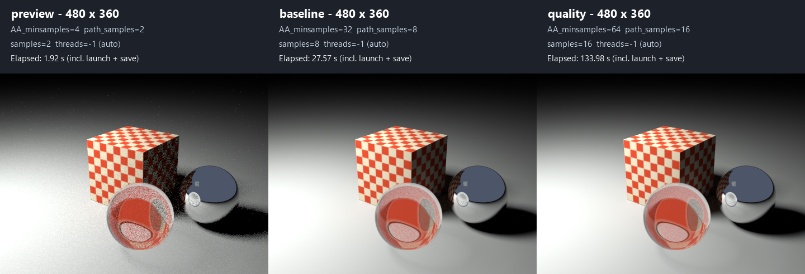
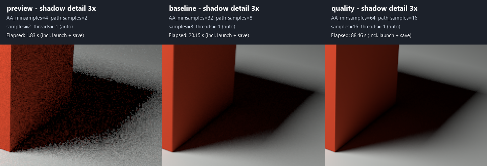

# Render a simple scene to TGA

This standalone C90 example uses the installed libYafaRay shared library. It
creates a red cube, a gray floor, a rectangular area light, a perspective camera
and a path tracing integrator. The renderer writes a 480 x 360 TGA image with 32
camera samples per pixel by default. No textures, scene files or optional image
libraries are required.

The library continues to use CMake. If it is not installed yet, follow the
[TDM-GCC-64 library build instructions](../hello/README.md#windows-tdm-gcc-64)
from the repository root. The default installation prefix is
`build/install/tdm-gcc64-shared` in the repository.

## Build and run

From the repository root in PowerShell:

```powershell
Set-Location examples/render_scene
xmake f -p mingw -a x86_64 -m release --sdk=C:/temp/TDM-GCC-64
xmake
xmake run yafaray_render_scene
```

The image is saved to `examples/render_scene/build/scene.tga` relative to the
repository root. The run directory is `examples/render_scene/build`, so generated
images stay in the ignored build directory. An existing output file is overwritten.

To choose an output path, pass an absolute path with an existing parent directory:

```powershell
xmake run yafaray_render_scene "C:/path/to/result.tga"
```

The filename must end with `.tga` or `.TGA`. A relative output path is resolved
against the run directory. The example checks API compatibility, scene setup,
preprocessing, and the saved TGA header and size; failures return a nonzero code.

## Compare quality and rendering time without rebuilding

After building once, pass these options to `xmake run yafaray_render_scene`:

| Option | libYafaRay parameter | Default | Allowed values |
| --- | --- | --- | --- |
| `--aa-samples N` | Film `AA_minsamples` | `32` | Positive integer |
| `--path-samples N` | Integrator `path_samples` | `8` | Positive integer |
| `--light-samples N` | Area light `samples` | `8` | Positive integer |
| `--threads N` | Integrator `threads` | `2` | Positive integer, or `-1` for automatic detection |

Integers must fit in a C `int` (up to 2147483647 for this toolchain). Very large
values can be impractical. Zero, fractions, missing values and unknown options
are rejected before an output file is opened. `--name=N` is also supported.
Repeated options use the last value. `--help` shows usage without rendering.
The output filename is optional and can appear before or after the options;
omitting it uses `scene.tga`. Existing invocations with just a filename still work.

Run these commands from `examples/render_scene`:

```powershell
# Fast, noisy preview
xmake run yafaray_render_scene preview.tga --aa-samples 4 --path-samples 2 --light-samples 2 --threads 2

# Previous quality settings, explicitly specified
xmake run yafaray_render_scene baseline.tga --aa-samples 32 --path-samples 8 --light-samples 8 --threads 2

# More samples for cleaner indirect light and shadows; takes longer
xmake run yafaray_render_scene quality.tga --aa-samples 64 --path-samples 16 --light-samples 16 --threads 2

# Let libYafaRay detect the worker count
xmake run yafaray_render_scene auto.tga --threads=-1

# Help only
xmake run yafaray_render_scene --help
```

These files appear in `examples/render_scene/build`. At startup the example
prints all four selected settings. libYafaRay reports its actual worker count
and `Overall rendertime` in seconds at the end of the render. Compare those
times with separate output images; the renderer time excludes example startup
and the final TGA write. For a quality comparison keep the worker count fixed
and change one sampling option at a time. To compare parallel performance,
keep all sample counts fixed and vary only `--threads`. Timings can vary with
other work on the machine, and Monte Carlo noise may vary between runs.

For a different installed MinGW x64 shared library:

```powershell
xmake f -p mingw -a x86_64 -m release --sdk=C:/temp/TDM-GCC-64 --yafaray_prefix=C:/path/to/install
```

## Run all quality profiles

Requirements for the comparison script: Python 3.8 or newer available as
`python`, in addition to PowerShell and the configured xmake example. PNG
generation uses the Python standard library; Pillow and external converters
are not needed. Python is checked before rendering starts.

After configuring and building the example once, run from the repository root:

```powershell
.\examples\render_scene\compare_quality.ps1
```

Or from `examples/render_scene`:

```powershell
.\compare_quality.ps1 -Threads 2
.\compare_quality.ps1 -Threads -1 -OutputDirectory 'C:/renders/libYafaRay comparison'
```

The script runs three profiles sequentially through `xmake run`, without
rebuilding. The default `-Threads -1` lets the library select the worker count;
use the same explicit count for repeatable comparisons.

| Profile | `AA_minsamples` | `path_samples` | Light `samples` | TGA filename |
| --- | --- | --- | --- | --- |
| preview | 4 | 2 | 2 | `preview-aa4-path2-light2.tga` |
| baseline | 32 | 8 | 8 | `baseline-aa32-path8-light8.tga` |
| quality | 64 | 16 | 16 | `quality-aa64-path16-light16.tga` |

Every run gets a new timestamped subdirectory under
`examples/render_scene/build/quality-comparison` (or `-OutputDirectory`). Each
image has a matching `.log`; `timings.csv` records settings, requested threads,
elapsed seconds and paths. Relative `-OutputDirectory` paths are relative to the
directory from which the script is called. The script prints per-profile and
total time, stops on failure, and preserves already completed measurements.

After all three renders succeed, the script automatically creates:

- `comparison.png`: the three complete images side by side, 1440 x 360 pixels.
- `comparison-detail.png`: identical 160 x 120 crops of the dark face and shadow,
  enlarged 3x without smoothing, also 1440 x 360 pixels.

Both use the order **preview — baseline — quality**, from left to right. RGB
values are copied from the TGA files without color correction or denoising.
The source TGA files are preserved. The crop is fixed for this example's
480 x 360 camera view; adjust `create_comparison.py` if the framing changes.
Malformed, missing or unsupported TGA files cause a clear error.

To generate or regenerate the PNGs for an existing run without rendering:

```powershell
# From the repository root; replace the directory with your own run
.\examples\render_scene\compare_quality.ps1 -ExistingRunDirectory '.\examples\render_scene\build\quality-comparison\20261103-195010-004'
```

This mode only needs Python and the three TGA files with the profile filenames
shown above; it does not launch xmake or use `-Threads`/`-OutputDirectory`.
Existing comparison PNGs in that run directory are overwritten.

The script measures elapsed wall time including the xmake launch, rendering,
TGA writing and log capture. The renderer-only time is also available in each
log as `Overall rendertime`. The profiles change several sample counts together
to compare overall presets; use individual CLI options to isolate one setting.
The total script time also includes PNG generation, while per-profile CSV times
continue to measure only their individual render invocations.

Measured on this machine on 3 November 2026, with the installed TDM-GCC-64
Release shared library, 480 x 360 output and `-Threads -1` (8 detected workers):

| Profile | Elapsed wall time | Renderer-only time |
| --- | --- | --- |
| preview | 1.83 s | 0.758 s |
| baseline | 20.15 s | 19.071 s |
| quality | 88.46 s | 87.432 s |
| Entire script | 110.50 s (1 min 50.5 s) | — |

Budget approximately 2 minutes for this complete set under similar conditions.
This is a single measured run, not a guarantee; worker count, CPU load, hardware
and build configuration affect time. Increasing several sample counts together
does not produce a simple linear runtime increase. Build/configuration time is
not included because the script uses the already-built example.
These measurements predate automatic PNG generation; generating both PNGs from
the existing images adds a small conversion overhead to future full runs.

### Visual comparison: preview, baseline and quality

Left to right: **preview — baseline — quality**, from the same measured run
above. Each panel shows the original 480 x 360 render, converted losslessly
from TGA to PNG for display in this README.



The same crop of the dark cube face and shadow is enlarged 3x below, in the
same order, using nearest-neighbor scaling so smoothing does not hide noise.



| Profile | Elapsed time | Visible quality | When to use it |
| --- | --- | --- | --- |
| preview | 1.83 s | Strong grain on the cube, floor and penumbra; lighting and composition are already clear | Quick iteration on geometry, camera and lighting |
| baseline | 20.15 s | A large reduction in noise; almost smooth surfaces and a clearly readable soft shadow | Routine evaluation and most finished images of this simple scene |
| quality | 88.46 s | Cleaner dark face and smoother penumbra; the improvement is subtle at normal display size | Final output when inspecting enlarged details or when residual noise matters |

For this scene, **baseline offers the best balance of quality and time**.
The jump from preview to baseline is clearly visible and worthwhile for a
finished image. Quality costs about **4.4 times** as much as baseline, while
its improvement is mainly visible in the enlarged crop. Use preview while
adjusting the scene, baseline to judge the result, and quality selectively for
the final render. This conclusion applies to this scene and resolution; more
complex lighting can need different sampling settings.

These images are documentation assets stored outside the ignored build tree,
so cleaning generated renders does not remove this comparison.

Only installed headers and `lib/liblibyafaray4.dll.a` are used for compilation and
linking. `xmake run` adds the installation's `bin` directory to the child process's
PATH for loading `libyafaray4.dll`; the global environment is unchanged. Direct
executable launches need this DLL directory and the toolchain runtimes in PATH.

## Scene walkthrough

`render_scene.c` follows these steps:

1. Create the logger, scene and parameter maps.
2. Create two materials and triangle meshes for the cube, floor and emitter.
3. Add an area light linked to the emitter mesh and a constant background.
4. Configure path tracing, the film, anti-aliasing and perspective camera.
5. Attach a TGA output, preprocess the scene and render.
6. Check the file and release the library objects.

Material colors, light position/power and camera coordinates are deliberately
defined in the source for easy experimentation.

## Soft shadows and indirect lighting

All settings below are passed through `yafaray_setParamMap*` before creating the
light, integrator or film. They are implemented by the installed shared library;
no optional dependencies or library rebuild are needed.
The sampling and worker values in the tables are defaults; the command-line
options above override them at runtime.

### Area light: shadow softness

The light's `type = "arealight"` replaces the original point light. A surface
point can see only part of this emitter when the cube blocks it, producing a
gradual shadow edge (penumbra).

| Light parameter | Value in the example | Meaning |
| --- | --- | --- |
| `corner` | `(-4.5, -5.5, 7)` | First corner of the rectangle |
| `point1` | `(-4.5, -2.5, 7)` | End of the first adjacent edge |
| `point2` | `(-1.5, -5.5, 7)` | End of the second adjacent edge |
| `object_name` | `"emitter"` | Matching scene mesh required by this version |
| `samples` | `8` | Samples of the light surface; more reduce shadow noise |
| `power` | `12.0` | Area light intensity, retuned for this scene |
| `color` | `(1.0, 0.95, 0.85, 1.0)` | Slightly warm light |

The rectangle is 3 x 3 scene units. Larger apparent emitter size gives softer
shadows; increasing `samples` makes their estimate cleaner without changing the
physical size. `point1` and `point2` are absolute positions, not edge vectors.
Their ordering makes the one-sided emitter face down toward the scene. Keep the
four `emitter_vertices` in sync with these three parameters when changing it.
Changing emitter size can also change illumination; retune `power` as needed.
Point-light and area-light power values are not interchangeable.

### Path tracing: reflected light

The integrator's `type = "pathtracing"` replaces `"directlighting"`. It samples
diffuse reflection paths, allowing the illuminated floor to bounce light onto the
cube's side facing away from the emitter. The cube also casts some red reflected
light onto the nearby floor. No extra fill light or self-emitting cube material
is used.

| Integrator parameter | Value | Meaning |
| --- | --- | --- |
| `path_samples` | `8` | Number of sampled diffuse paths per camera sample |
| `bounces` | `3` | Maximum diffuse path depth |
| `russian_roulette_min_bounces` | `3` | Avoid early random termination within the chosen depth |
| `threads` | `2` | Render worker count; affects speed, not lighting |

Increasing `path_samples` reduces indirect-light noise at a time cost. Increasing
`bounces` allows longer reflection paths; it does not directly multiply brightness.
The unlit side should remain darker than the directly lit faces.

The constant background remains a backdrop. In this version, the diffuse path
loop skips paths that miss the scene, so merely brightening that background does
not provide the floor-to-cube indirect lighting used here. Ambient occlusion
(`do_AO`) is also not used as a substitute for reflected light.

### Film: sampling and render time

The film uses `AA_passes = 1` and `AA_minsamples = 32` (previously 16). These
control camera/pixel sampling and help with edges and Monte Carlo noise.
They do not enable indirect light or determine shadow softness by themselves.
Camera samples, diffuse paths and area-light samples all contribute work, so
this version takes longer than the original direct-lighting render. For quick
previews, lower `AA_minsamples` or `path_samples`; for cleaner output, raise them.

Parameter names and behavior were checked against this repository's
`include/light/light_area.h`, `src/light/light_area.cc`,
`include/integrator/surface/integrator_path_tracer.h`,
`src/integrator/surface/integrator_path_tracer.cc` and
`include/render/imagefilm.h`.

Verified on 3 November 2026 using the installed shared library from commit
`8f4906ae88f8a527bbce37991a95e3e3857cb9ac`, TDM-GCC-64 10.3.0 and xmake 3.1.2:
build and rendering succeeded; the TGA was decoded and visually inspected.
The updated area-light/path-tracing scene rendered in approximately 41 seconds
on this machine with two render threads. The shadow has a visible penumbra and
the formerly black cube face receives reflected light from the floor. Timing
depends on hardware; some Monte Carlo noise remains at these preview settings.
