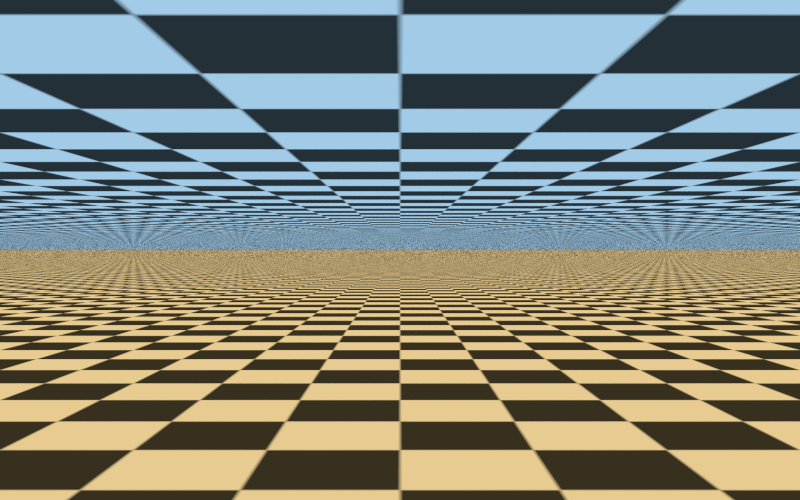

# Periodic textures approaching the horizon

An independent C90/xmake example using the installed MinGW x64 shared libYafaRay
library. A warm checkerboard floor at `z = 0` and a cool checkerboard ceiling at
`z = 3` extend to `y = 10000`. The horizontal camera sits halfway between them,
at `(0, 0, 1.5)`, looking along positive Y. Output is 800 x 500 TGA.

The floor repeats every **2 world units**; the ceiling repeats every **3.4 units**.
One repeat contains two cells per axis, so their cell widths are 1 and 1.7 units.
Both patterns are 64 x 64 RGB images generated in memory. UVs are computed as
`(x / period, y / period)` and the image texture repeats over the planes.
The opposite triangle winding makes the floor face up and the ceiling face down.

Both materials use `shinydiffusemat` with `emit = 1` and a texture connected to
`diffuse_shader`. Their brightness is uniform and independent of distance:
lighting, shadows and indirect-light noise cannot hide texture-sampling artifacts.
There are intentionally no light objects. The corresponding "Lights not found"
warning is expected; the materials are self-emitting. Geometry is finite, not
an actual infinite plane, but it extends far enough for this view.

## Build and run

First build/install the shared library using the
[TDM-GCC-64 instructions](../hello/README.md#windows-tdm-gcc-64).
Then, from the repository root in PowerShell:

```powershell
Set-Location examples/texture_horizon
xmake f -p mingw -a x86_64 -m release --sdk=C:/temp/TDM-GCC-64
xmake
xmake run yafaray_texture_horizon
```

The default output is `examples/texture_horizon/build/horizon.tga`. Existing
output files are overwritten; relative output paths are relative to that build
directory. A different installation can be selected with
`--yafaray_prefix=C:/path/to/install` on the **xmake configuration** command.
Only installed public headers and the import library are used; `xmake run`
adds the installed DLL directory to the child process's PATH.

## Compare interpolation and camera sampling

Options follow the target name, accept separate values, and need no rebuild:

| Option | Default | Meaning |
| --- | --- | --- |
| `--filter none` | — | Nearest texel; no texture interpolation |
| `--filter bilinear` | `bilinear` | Blend four neighboring texels |
| `--filter bicubic` | — | Cubic interpolation of neighboring texels |
| `--aa-samples N` | `16` | Positive integer; film `AA_minsamples`, one AA pass |
| `--threads N` | `-1` | Positive worker count, or `-1` for auto |
| `--help` | — | Usage without rendering |

To isolate texture interpolation, keep camera sampling fixed:

```powershell
xmake run yafaray_texture_horizon none-aa16.tga --filter none --aa-samples 16
xmake run yafaray_texture_horizon bilinear-aa16.tga --filter bilinear --aa-samples 16
xmake run yafaray_texture_horizon bicubic-aa16.tga --filter bicubic --aa-samples 16
```

To isolate camera anti-aliasing, keep interpolation fixed:

```powershell
xmake run yafaray_texture_horizon bilinear-aa1.tga --filter bilinear --aa-samples 1
xmake run yafaray_texture_horizon bilinear-aa16.tga --filter bilinear --aa-samples 16
xmake run yafaray_texture_horizon bilinear-aa64.tga --filter bilinear --aa-samples 64
```

Open the TGAs at **100% display scale** first. Viewer resizing can add its own
filtering and change or conceal the moire. Compare the thin band around the
middle of the image, then the nearer rows of cells. The renderer logs
`Overall rendertime` for timing comparisons; keep thread count fixed to compare
quality costs. Periods, plane heights, colors and camera geometry can be changed
in `texture_horizon.c` and require rebuilding the example.

## What the experiment demonstrates

Perspective compresses distant repeats into less than a pixel. Eventually one
pixel covers many cells, and their correct spatial average should approach a
uniform value. The shorter-period floor reaches this condition sooner than the
ceiling at the same distance. A pixel footprint is also very elongated along the
plane near a grazing angle.

Nearest/bilinear/bicubic all sample the original-resolution image. Bilinear and
bicubic soften texel boundaries, but do not average every distant repetition
inside that elongated footprint. Thus they can still produce stripes, moire and
unstable detail near the horizon. Increasing `AA_minsamples` averages more camera
rays per output pixel, generally reducing these artifacts at a time cost; finite
sampling does not guarantee their complete removal. This example does not apply
post-render blur or denoising.

### Mipmaps and the installed library

This version of libYafaRay also defines `mipmap_trilinear` and `mipmap_ewa`
texture interpolation. Mipmaps prefilter progressively smaller images; EWA uses
an anisotropic footprint, particularly relevant at grazing angles. Proper use
also requires texture-coordinate ray differentials (this example supplies UVs).

However, **the currently installed shared library has OpenCV disabled**.
`image_manipulation::generateMipMaps` in `src/image/image_manipulation.cc`
requires OpenCV and otherwise returns an empty mipmap list with a warning.
This example therefore accepts only the three available base-image filters;
it does not pretend to compare working mipmap filters. Enabling and verifying
OpenCV in a separate library configuration would be the next experiment.

The present example keeps the library's existing CMake build unchanged.

## Verified output

Built and rendered on 3 November 2026 using TDM-GCC-64 10.3.0, xmake 3.1.2 and
the installed libYafaRay 4.0.0-pre-alpha shared library. Bilinear/16 camera samples
rendered in approximately 2.43 seconds with 8 detected workers. The scene and
texture periods were visually checked; time varies with hardware and settings.
Also verified: `none`/1 sample, `bicubic`/16 samples (3.27 s), and
`bilinear`/64 samples (11.73 s). All four TGA outputs passed header and size
checks; invalid filters and sample counts were rejected.


