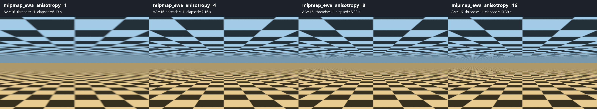
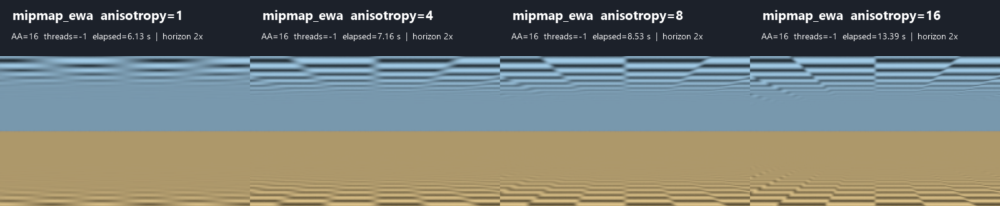
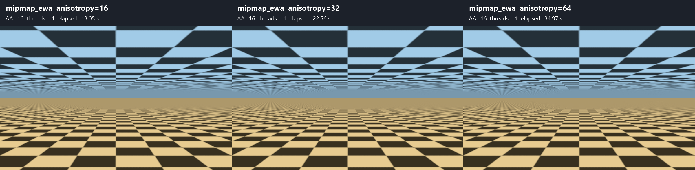
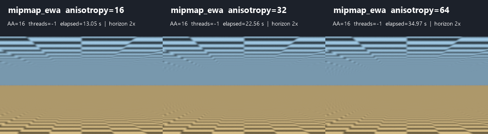
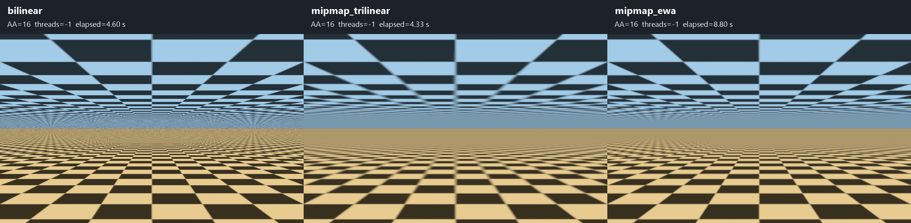
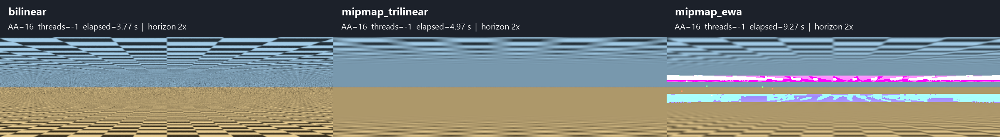
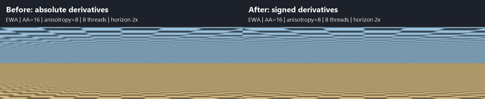

# Periodic textures approaching the horizon

An independent C90/xmake example using the installed MinGW x64 shared libYafaRay
library. A warm checkerboard floor at `z = 0` and a cool checkerboard ceiling at
`z = 3` extend to `y = 10000`. The horizontal camera sits halfway between them,
at `(0, 0, 1.5)`, looking along positive Y. Output is 800 x 500 TGA.

The floor repeats every **2 world units**; the ceiling repeats every **3.4 units**.
One repeat contains two cells per axis, so their cell widths are 1 and 1.7 units.
Both patterns are 64 x 64 RGB images generated in memory. UVs are computed as
`(x / period, y / period)` and the image texture repeats over the planes.
The opposite triangle winding makes the floor face up and the ceiling face down.

Both materials use `shinydiffusemat` with `emit = 1` and a texture connected to
`diffuse_shader`. Their brightness is uniform and independent of distance:
lighting, shadows and indirect-light noise cannot hide texture-sampling artifacts.
There are intentionally no light objects. The corresponding "Lights not found"
warning is expected; the materials are self-emitting. Geometry is finite, not
an actual infinite plane, but it extends far enough for this view.

## Build and run

First build/install the shared library using the
[TDM-GCC-64 instructions](../hello/README.md#windows-tdm-gcc-64).
Then, from the repository root in PowerShell:

```powershell
Set-Location examples/texture_horizon
xmake f -p mingw -a x86_64 -m release --sdk=C:/temp/TDM-GCC-64
xmake
xmake run yafaray_texture_horizon
```

The default output is `examples/texture_horizon/build/horizon.tga`. Existing
output files are overwritten; relative output paths are relative to that build
directory. A different installation can be selected with
`--yafaray_prefix=C:/path/to/install` on the **xmake configuration** command.
Only installed public headers and the import library are used; `xmake run`
adds the installed DLL directory to the child process's PATH.

## Compare interpolation and camera sampling

Options follow the target name, accept separate values, and need no rebuild:

| Option | Default | Meaning |
| --- | --- | --- |
| `--filter none` | — | Nearest texel; no texture interpolation |
| `--filter bilinear` | `bilinear` | Blend four neighboring texels |
| `--filter bicubic` | — | Cubic interpolation of neighboring texels |
| `--filter mipmap_trilinear` | — | Trilinear mipmap filtering; requires OpenCV-enabled DLL |
| `--filter mipmap_ewa` | — | Elliptical weighted average mipmap filtering; requires OpenCV-enabled DLL |
| `--ewa-max-anisotropy N` | `8` | Finite number >= 1 fitting in a float; EWA footprint aspect-ratio limit |
| `--aa-samples N` | `16` | Positive integer; film `AA_minsamples`, one AA pass |
| `--threads N` | `-1` | Positive worker count, or `-1` for auto |
| `--help` | — | Usage without rendering |

To isolate texture interpolation, keep camera sampling fixed:

```powershell
xmake run yafaray_texture_horizon none-aa16.tga --filter none --aa-samples 16
xmake run yafaray_texture_horizon bilinear-aa16.tga --filter bilinear --aa-samples 16
xmake run yafaray_texture_horizon bicubic-aa16.tga --filter bicubic --aa-samples 16
```

To isolate camera anti-aliasing, keep interpolation fixed:

```powershell
xmake run yafaray_texture_horizon bilinear-aa1.tga --filter bilinear --aa-samples 1
xmake run yafaray_texture_horizon bilinear-aa16.tga --filter bilinear --aa-samples 16
xmake run yafaray_texture_horizon bilinear-aa64.tga --filter bilinear --aa-samples 64
```

Open the TGAs at **100% display scale** first. Viewer resizing can add its own
filtering and change or conceal the moire. Compare the thin band around the
middle of the image, then the nearer rows of cells. The renderer logs
`Overall rendertime` for timing comparisons; keep thread count fixed to compare
quality costs. Periods, plane heights, colors and camera geometry can be changed
in `texture_horizon.c` and require rebuilding the example.

## What the experiment demonstrates

Perspective compresses distant repeats into less than a pixel. Eventually one
pixel covers many cells, and their correct spatial average should approach a
uniform value. The shorter-period floor reaches this condition sooner than the
ceiling at the same distance. A pixel footprint is also very elongated along the
plane near a grazing angle.

Nearest/bilinear/bicubic all sample the original-resolution image. Bilinear and
bicubic soften texel boundaries, but do not average every distant repetition
inside that elongated footprint. Thus they can still produce stripes, moire and
unstable detail near the horizon. Increasing `AA_minsamples` averages more camera
rays per output pixel, generally reducing these artifacts at a time cost; finite
sampling does not guarantee their complete removal. This example does not apply
post-render blur or denoising.

### Mipmaps and the installed library

This version of libYafaRay also defines `mipmap_trilinear` and `mipmap_ewa`
texture interpolation. Mipmaps prefilter progressively smaller images; EWA uses
an anisotropic footprint, particularly relevant at grazing angles. Proper use
also requires texture-coordinate ray differentials (this example supplies UVs).

The original `build/install/tdm-gcc64-shared` installation has OpenCV disabled.
Use the separate `tdm-gcc64-shared-opencv` installation below for mipmap filters.
`image_manipulation::generateMipMaps` in `src/image/image_manipulation.cc`
requires OpenCV and otherwise returns an empty mipmap list with a warning.
The example detects that warning during texture creation and stops before
rendering, instead of attempting to sample an unavailable mipmap chain.

The present example keeps the library's existing CMake build unchanged.

### Build OpenCV and a separate shared libYafaRay

From the repository root in PowerShell:

```powershell
.\examples\texture_horizon\build_opencv.ps1
# The shared OpenCV preset now also includes native PNG support.
.\examples\mirror_tunnel\build_png.ps1
.\examples\cloud_shadows\build_jpeg.ps1
$cmake = 'C:/Program Files/CMake/bin/cmake.exe'
& $cmake --preset tdm-gcc64-shared-opencv
& $cmake --build --preset tdm-gcc64-shared-opencv --parallel 4
& $cmake --install build/tdm-gcc64-shared-opencv
```

The script downloads the pinned OpenCV 4.10.0 source archive, verifies SHA256,
and builds static `core`, `imgproc` and `photo` modules using the same
`C:/temp/TDM-GCC-64` compiler. It installs to
`build/install/opencv-4.10.0-tdm-gcc64`. These are linked into the separate
shared libYafaRay at `build/install/tdm-gcc64-shared-opencv`; the original
installation is retained. The first source build takes much longer than a render.
OpenCV tests, examples, Python bindings, IPP and OpenCL are disabled.

Select this DLL installation for the example:

```powershell
Set-Location examples/texture_horizon
xmake f -p mingw -a x86_64 -m release --sdk=C:/temp/TDM-GCC-64 --yafaray_prefix=../../build/install/tdm-gcc64-shared-opencv
xmake
.\compare_filters.ps1 -AaSamples 16 -Threads -1
```

The comparison runs `bilinear`, `mipmap_trilinear` and `mipmap_ewa` sequentially
at the same resolution, geometry, UVs, AA count and worker count. It saves TGA,
individual PNGs, verbose logs, `timings.csv`, a labeled side-by-side
`comparison.png`, and `comparison-horizon.png` (the middle 400 x 120 region
enlarged 2x without smoothing) in a timestamped `build/filter-comparison` folder.
PNG generation needs Python 3 and Windows .NET System.Drawing; no Python image
packages are required. Elapsed times in headings include launch and TGA saving.
Logs should confirm mipmap generation, rather than report the missing-OpenCV warning.

The scene automatically enables ray differentials when it contains mipmapped
textures; UV coordinates let the mapper compute their pixel footprints.
Trilinear chooses/blends isotropic mip levels, often blurring grazing-angle
detail. EWA adapts to an elongated footprint, aiming to preserve more detail
while suppressing aliasing. Neither changes the geometry or either texture period.

### Compare EWA anisotropy limits

Both anisotropy comparisons below were repeated on 4 November 2026 after
the derivative-sign correction. Their images, times and recommendations use
the corrected OpenCV-enabled shared library, including the earlier bounds fixes.

`--ewa-max-anisotropy` sets the image texture parameter `ewa_max_anisotropy`
for both the floor and ceiling, without recompiling. It only affects
`--filter mipmap_ewa`; other filters ignore it. Fractional values such as `4.5`
are supported. Zero, negative values, NaN, infinity and values outside the float
range are rejected before rendering. The default of 8 preserves prior behavior.

After selecting the OpenCV-enabled installation and building the example, run
from `examples/texture_horizon`:

```powershell
xmake run yafaray_texture_horizon ewa16.tga --filter mipmap_ewa --ewa-max-anisotropy 16 --aa-samples 16 --threads -1

# Run all four limits at the same AA and thread settings
.\compare_filters.ps1 -AnisotropyComparison -AaSamples 16 -Threads -1

# Choose a different set of limits, preserving the supplied order
.\compare_filters.ps1 -AnisotropyComparison -AnisotropyLimits 16,32,64 -AaSamples 16 -Threads -1
```

The batch creates `ewa-1`, `ewa-4`, `ewa-8` and `ewa-16` TGA/PNG files, logs,
`timings.csv` and labeled comparison PNGs in a timestamped
`build/anisotropy-comparison` directory. The full comparison is 3200 x 590;
the horizon comparison is 1600 x 330, showing the same central 200 x 120 crop
from each image at 2x enlargement with no smoothing. In both, the order is
**1 — 4 — 8 — 16**, left to right. Existing three-filter comparison commands
continue to work without `-AnisotropyComparison`.
`-AnisotropyLimits` accepts distinct positive integers and defaults to
`1,4,8,16`. With a custom list, filenames and headings follow those values;
each full-view column is 800 pixels wide and each 2x horizon column is 400
pixels wide. Pass the same list when regenerating that run's images with
`-ExistingRunDirectory`.

To regenerate images from a completed anisotropy run without rendering again:

```powershell
.\compare_filters.ps1 -AnisotropyComparison -ExistingRunDirectory build/anisotropy-comparison/20261104-075645-552
```

Measured on 4 November 2026 using the fixed OpenCV-enabled shared library,
800 x 500, AA=16 and 8 automatically detected workers, with identical geometry,
UVs, periods and materials in every render. All four values were rendered again;
these outputs replace the pre-sign-fix images and measurements from 3 November.
Run directory: `build/anisotropy-comparison/20261104-075645-552`.

| `ewa_max_anisotropy` | Renderer-only time | Launch + render + TGA save | Observed result |
| --- | --- | --- | --- |
| 1 | 4.195 s | 5.186 s | Broad isotropic blur; distant cell rows disappear early |
| 4 | 6.031 s | 7.035 s | Much better distant detail; useful faster preview |
| 8 | 8.535 s | 9.574 s | More distant cells survive; useful balance |
| 16 | 11.437 s | 12.416 s | Clearest distant pattern in this set; a smaller additional gain |





The limit caps how elongated the EWA footprint may be. At 1, the short axis is
expanded to the long-axis length, making the footprint isotropic. Higher limits
allow more anisotropy, reducing unnecessary blur perpendicular to the direction
of greatest compression. This is not a count of samples or mipmap levels, and
does not change texture frequency or AA. All four images still converge to an
average at sufficiently small projected periods.

For the displayed central crop (`x=300..499`, `y=190..309`, 24,000 pixels),
the saved 8-bit RGB differences also show diminishing changes:

| Pair | Mean absolute channel difference (0..255) | Pixels with any channel differing by more than 2 |
| --- | --- | --- |
| 1 vs 4 | 5.10351 | 9,108 / 24,000 (37.95%) |
| 4 vs 8 | 0.90508 | 2,700 / 24,000 (11.25%) |
| 8 vs 16 | 0.43361 | 1,463 / 24,000 (6.096%) |

These measure change between outputs, not accuracy against a ground-truth
reference. The corrected images have balanced smoothing on both sides.

**Use 8 as the general starting point for this scene.** Limit 4 is a faster
preview with a clear improvement over 1: it takes about 29% less renderer time
than 8. Limit 1 is useful as an isotropic-blur reference or when speed matters
more than distant detail. Limit 16 is worthwhile when preserving distant cells
matters: it costs about **1.34x** the renderer time of 8 here, with a visible
but smaller quality gain than the step from 1 to 4. The corrected 16/32/64
comparison below supports stopping at 16 for this view. Larger limits can
retain more residual aliasing at finite AA, so sharper does not automatically
mean a more accurate result. These are single-run measurements, not universal
timing guarantees. No colored artifacts were found in any of the four outputs.

#### Does increasing anisotropy beyond 16 help at AA=16?

The follow-up run compares **16 — 32 — 64**, left to right, with the same
OpenCV-enabled DLL with both the bounds and derivative-sign fixes, 800 x 500
scene, AA=16 and 8 detected workers. All three values, including 16, were
rendered again on **4 November 2026** using the installed shared library.
The images, times and differences below replace the pre-sign-fix comparison
from 3 November; they do not reuse its outputs.
Run directory: `build/anisotropy-comparison/20261104-075322-073`.

```powershell
.\compare_filters.ps1 -AnisotropyComparison -AnisotropyLimits 16,32,64 -AaSamples 16 -Threads -1
```

| `ewa_max_anisotropy` | Renderer-only time | Launch + render + TGA save | Relative renderer time |
| --- | --- | --- | --- |
| 16 | 11.898 s | 12.923 s | 1.00x |
| 32 | 20.122 s | 21.120 s | 1.69x |
| 64 | 36.010 s | 36.998 s | 3.03x |



Identical central horizon crops at 2x enlargement, without smoothing:



After the sign correction, the visible change above 16 is even smaller in this
view. Some individual distant edges change subtly between 16 and 32; 32 and 64
are visually indistinguishable in the enlarged crop. The smoothing is balanced
on the left and right. The nearby floor/ceiling remain effectively the same.
All three outputs passed the scene-specific color check with zero invalid pixels.

For a numerical comparison of the displayed crop (original coordinates
`x = 300..499`, `y = 190..309`, 24,000 pixels), using the saved 8-bit RGB values:

| Pair | Mean absolute channel difference, on a 0..255 scale | Pixels with any channel differing by more than 2 |
| --- | --- | --- |
| 16 vs 32 | 0.07521 | 88 / 24,000 (0.367%) |
| 32 vs 64 | 0.01140 | 0 / 24,000 (0%) |

These numbers measure similarity between the outputs, not error against a
ground-truth reference. They support the visual observation that the extra
cost buys very little visible change in this particular scene at AA=16.
For context, before the sign correction these same crop metrics were 0.152 /
1.90% for 16 vs 32 and 0.0255 / 0.063% for 32 vs 64. The old comparison
included the incorrectly oriented footprint, which exaggerated the differences.

**Keep 16 when this level of distant detail is needed; increasing to 32 or 64
is not justified for routine renders of this view:** 32 costs about 69% more
renderer time, and 64 costs about three times as much as 16, with negligible
visible benefit. The corrected 1/4/8/16 sweep above independently supports
8 as a balanced starting point and 16 when distant detail matters; its times
come from a separate run, so use each table's own 16 result for timing ratios.
Anisotropy is a maximum allowed
footprint ratio, not a fixed sample count; raising it does not guarantee a
visible change or a more accurate result. Other textures, camera angles,
resolutions or AA settings may produce a different tradeoff. All times are
single-run local measurements.

### Measured comparison with OpenCV

All three modes were run with the **same OpenCV-enabled DLL**, 800 x 500 output,
16 camera samples per pixel and 8 automatically detected render workers on
4 November 2026. OpenCV 4.10.0 was built from source using TDM-GCC-64 10.3.0;
libYafaRay identifies itself as `4.0.0-pre-alpha+git.g5448d81b.dirty`.
The comparison run after both the EWA bounds and derivative-sign fixes below is
`build/filter-comparison/20261104-074013-022`.
Both mipmap modes logged 6 generated levels per texture and enabled ray
differentials. No denoising, extra blur or color correction was applied.

| Filter | Renderer-only time | Launch + render + TGA save | Observed result |
| --- | --- | --- | --- |
| `bilinear` | 2.853 s | 12.272 s | Sharp nearby cells, but grain/moire in the horizon band |
| `mipmap_trilinear` | 4.563 s | 7.529 s | Horizon converges to a stable average; visible isotropic blur starts earlier |
| `mipmap_ewa` | 10.155 s | 11.697 s | Symmetric smoothing; distant detail survives before converging to the average, without colored bands |

Left to right: **bilinear — mipmap_trilinear — mipmap_ewa**.
Headings display elapsed time including launch and saving, rounded to two decimals.



The same horizon region at 2x enlargement without smoothing:



**EWA now gives the best detail-preserving smoothing in this comparison.**
It removes the colored bands after the bounds fixes and the left/right blur
imbalance after preserving derivative signs, while retaining more visible
distant cells than Trilinear. It takes about **3.6x Bilinear's** renderer time
(2.2x Trilinear's). Trilinear is the faster, softer option, at about
1.6x Bilinear's renderer time; Bilinear remains the aliasing reference.
Some residual patterning can still occur during the transition at finite AA
and the default EWA anisotropy limit of 8. The fix addresses invalid memory
reads and spurious colors, not a guarantee of perfect filtering at every angle.
Wall time includes xmake startup and saving; this run had substantial startup
overhead, particularly for Bilinear. These single-run times should not be used
to attribute a performance change to the sign correction.

#### EWA derivative signs and symmetry control

The EWA implementation previously applied `std::abs` independently to all four
UV derivatives in `ImageTexture::mipMapsEwaInterpolation`. This preserved their
lengths but destroyed the orientation of the texture footprint. The ellipse's
mixed coefficient is `B = -2 * (ds_dx * dt_dx + ds_dy * dt_dy)` after scaling
to texels. On reflection its sign must change with the footprint; taking
absolute values prevented that, producing excess contrast on the left side.

The correction keeps all four derivatives signed. Length calculations already
square the components, and the anisotropy adjustment multiplies a complete
vector by a positive scale, so neither operation needs absolute values.
The library was rebuilt and installed with the OpenCV CMake preset before
rendering the control with unchanged geometry, textures, AA=16, anisotropy=8
and 8 automatically selected workers.

Left: before (3 November run `20261103-211354-226`); right: after
(4 November run `20261104-074013-022`). Both show the same central 400 x 120
region, enlarged 2x with nearest-neighbor sampling and no image repair.



Contrast below is the mean of per-row population standard deviations of the
red channel (8-bit output), measured in mirrored regions `x=[200,400)` and
`x=[400,600)`. Coordinates refer to the original 800 x 500 image, with Y from
the top. Relative imbalance is `abs(L-R) / ((L+R)/2)`.

| Region, Y range | Before L / R | Before imbalance | After L / R | After imbalance |
| --- | --- | --- | --- | --- |
| Ceiling, 190–209 | 32.314 / 31.645 | 2.09% | 31.551 / 31.645 | 0.30% |
| Ceiling, 210–229 | 8.072 / 6.531 | 21.11% | 6.558 / 6.531 | 0.40% |
| Floor, 270–289 | 2.824 / 1.508 | 60.73% | 1.503 / 1.508 | 0.32% |
| Floor, 290–309 | 28.220 / 26.011 | 8.15% | 26.008 / 26.011 | 0.01% |

The control confirms that the apparent extra left-side detail was real and
caused by the incorrect footprint orientation. Correct filtering reduces that
excess contrast and restores balanced smoothing. Exact pixel symmetry is not
required because the checker phase and finite camera sampling differ across
the center. The small residual contrast differences are comparable to the
sampling differences observed with the other filters; this is a scene-specific
diagnostic, not proof of correctness for every texture or view.

To reproduce the measurements and the unlabeled before/after crop:

```powershell
python -B compare_ewa_symmetry.py build/filter-comparison/20261103-211354-226/mipmap_ewa.tga build/filter-comparison/20261104-074013-022/mipmap_ewa.tga build/ewa-symmetry.png
```

The previous EWA renderer time was 7.780 s (8.798 s including launch/save);
the control took 10.155 s (11.697 s total). These were different sessions,
and the reference filters also changed time, so this is not an isolated
performance benchmark. All three new outputs passed the color-range/hue check
with **zero invalid pixels**. The existing modulo regression test also passes.

#### EWA bug and regression checks

The original comparison (`build/filter-comparison/20261103-205949-016`) exposed
bright colored bands. A color-range/hue regression check counted 16,450 invalid
pixels in that EWA image, versus zero in Bilinear and Trilinear. The cause was
out-of-bounds texel access, not normal moire or a property of EWA filtering.

Runtime instrumentation caught texel `(11, 16)` being read from a 16 x 16 mipmap:
the original Y coordinate was `-16`. `math::mod(-16, 16)` returned **16**, because
the helper added the divisor for every negative input, including exact multiples
whose remainder was already zero. The fix in `include/math/math.h` adds the
divisor only when the **remainder** is negative, keeping wrapped indices in
`[0, size)`.

An additional bounds fix in `ImageTexture::ewaEllipticCalculation` samples
`(0, 0)` directly at the coarsest 1 x 1 mipmap level; the old code incorrectly
used the original image dimensions for that level's coordinate wrap. Correcting
this second issue alone did not eliminate the colored bands; the modulo fix
addresses the observed root cause. Temporary instrumentation was removed.

The standalone C++17 regression test failed before the modulo correction and
passes after it. It checks negative exact multiples, 1 x 1 textures, ordinary
negative coordinates, and index bounds/congruence over positive and negative
coordinates at all power-of-two sizes from 1 through 64. From the repository root:

```powershell
& C:/temp/TDM-GCC-64/bin/g++.exe -std=c++17 -I include tests/regression/math_mod.cc -o build/math_mod_test.exe
& ./build/math_mod_test.exe
```

For a full comparison run, check the rendered pixels as well (substitute your
run directory):

```powershell
python -B examples/texture_horizon/verify_filter_outputs.py examples/texture_horizon/build/filter-comparison/RUN_DIRECTORY
```

This scene-specific check validates texture hue ordering and maximum intensity
outside a narrow floor/ceiling boundary band where AA mixes both palettes. It
does not establish a general image-quality score and assumes this example's
original self-emitting materials and colors.

After rebuilding and installing `tdm-gcc64-shared-opencv`, the complete comparison
was repeated with unchanged scene and sampling settings. The new check reports
**zero invalid pixels for Bilinear, Trilinear and EWA**, and both comparison PNGs
above were replaced with this verified run. No post-render repair was applied.

The comparison images are kept in `images/` so cleaning `build/` does not remove
the documented result. Timings are a single local measurement, not a guarantee.

## Verified output

Built and rendered on 3 November 2026 using TDM-GCC-64 10.3.0, xmake 3.1.2 and
the installed libYafaRay 4.0.0-pre-alpha shared library. Bilinear/16 camera samples
rendered in approximately 2.43 seconds with 8 detected workers. The scene and
texture periods were visually checked; time varies with hardware and settings.
Also verified: `none`/1 sample, `bicubic`/16 samples (3.27 s), and
`bilinear`/64 samples (11.73 s). All four TGA outputs passed header and size
checks; invalid filters and sample counts were rejected.


